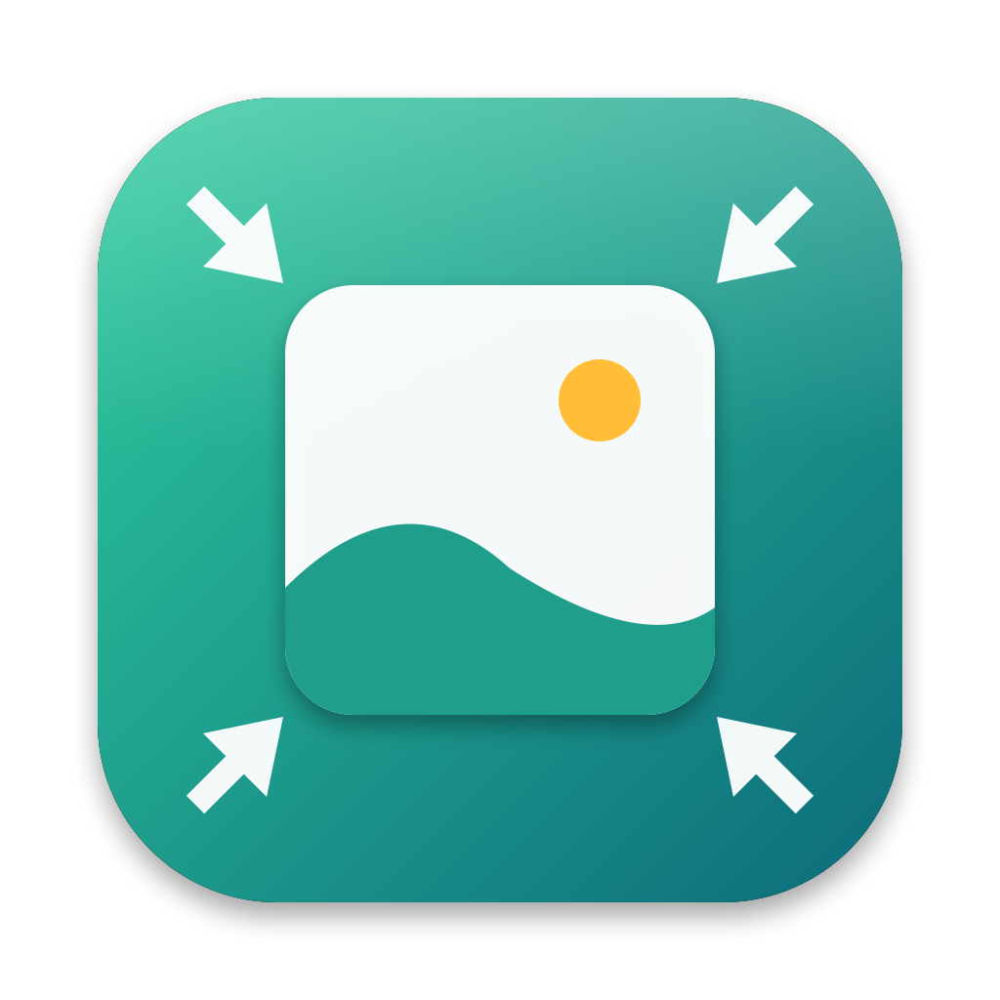

<div align="center">



# 📦 Shrinkbox

**Make images, videos, audio files and PDFs smaller on macOS: drop them, copy them, or let a folder do it.**


[](https://www.swift.org/)
[](https://www.apple.com/macos/)
[](https://developer.apple.com/xcode/swiftui/)
[](https://github.com/Arrows78/Shrinkbox/actions/workflows/ci.yml)

</div>

**Shrinkbox** lives in the menu bar and makes your files lighter without changing how you work. Drag files onto a drop zone, copy a screenshot, or point it at a folder: each file comes back smaller in a small floating card that shows the saving and lets you undo it, crop it, convert it or fit it under a size. It works with the frameworks of macOS alone, and uses a few well-known command-line tools when you have them. Drag a HEIC onto it and get a JPEG, drop a screen recording and get a GIF or a lighter MP4.

> [!NOTE]
> Shrinkbox has no account and no analytics. Files are processed on your Mac. The only network use is downloading a link you drop on it: see [What leaves your Mac](#-what-leaves-your-mac).

## ✨ Features

### 🖼️ Images

- **JPEG, HEIC, PNG, GIF, WebP, AVIF, TIFF, BMP, JXL** in, with a compression level from 5 (best quality) to 100 (smallest file), `adaptive` to let Shrinkbox choose, or `lossless`.
- **PNG palettes** with error diffusion, written by Shrinkbox itself: no `pngquant` needed. Transparent images keep their transparency.
- **Adaptive format** (opt-in): photographs go to JPEG and flat graphics to PNG.
- **Animated GIFs** keep their frames. Above 80 % compression every 4th, 3rd or 2nd frame can be dropped, and the animation either plays faster or keeps its duration.
- **Crop and resize** to a size (`1200x630`), to a long edge (`1920`) or to a shape (`16:9`, `1:1`, `1.91:1`). A file already at that size is left alone.
- **Smart crop** centres the crop on what the eye goes to (Vision saliency) instead of the middle.
- **Downscale** by a factor, and **metadata removal** (EXIF, GPS, XMP) that keeps the pixels and, if you want, the colour profile.
- **WebP and AVIF output** with `cwebp` and `heif-enc` when they are installed.

### 🎞️ Videos

- **Smaller MP4 and MOV** through the media engine of your Mac (H.264, HEVC), with a bitrate worked out from the level and never above the source's.
- **Crop, downscale, remove the audio, change the speed** (2× keeping every frame or dropping frames back to the source rate), **cap the frame rate**.
- **Convert to GIF** from any video, or to MP4, HEVC, AV1 and WebM when `ffmpeg` is installed (it also reads MKV, AVI, MPG and the like).
- **Target size**: encode a clip to fit under 10 MB, 25 MB or any limit, retrying with a lower bitrate until it does.
- **Watermark** an image or a video, **strip metadata** without re-encoding.

### 🎧 Audio

- **WAV, AIFF and FLAC to AAC (M4A)** with a bitrate you choose or one derived from the level. A bitrate is never raised.
- **MP3 and Ogg** with `ffmpeg`. **Loudness normalisation**, **speed change**, cover art kept, optimised or removed.

### 📄 PDFs

- **Downsample and recompress the images** inside a PDF to 300, 250, 200, 150, 100, 72 or 48 dpi, or let Shrinkbox pick from the level. Text stays vector. Ghostscript is used instead when installed.
- **Crop pages without losing content**: only the crop box changes, and **uncrop** brings the original size back.
- **Pages as images**: JPEG or PNG at 1×, 2× or 3×.

### 🪟 Floating results

- **A card per file**: thumbnail, `12 MB → 3 MB  -75%`, and buttons for downscale, recompress, crop, share, restore the original, Quick Look, Save as…, Show in Finder, copy, **fit under a size**, aggressive optimisation. You choose which buttons show.
- **Change the format** by clicking the extension on the card (HEIC → JPEG, MOV → MP4 or GIF, WAV → M4A…).
- **Drag a result out** into any app.
- **Compact layout** (one line each) automatically beyond five results, or always. Copy all, clear all.
- **Follow the cursor** across screens, any corner, auto-hide delays per kind. Off, Shrinkbox keeps working with no window at all.
- **Restore the original** of any file: Shrinkbox keeps a copy of what it replaced.

### 📥 Drop zone and clipboard

- **Drop zone**: drag files, folders, paths or links toward it and it appears in a corner. Dropped links are downloaded first. Hold ⌥ Option to show it only on demand.
- **Preset zones**: hold ⌃ Control while dragging and zones appear around it; dropping a file on one runs its pipeline ("Web ready", "Discord 10 MB", "Square avatar"…).
- **Batch mode** for large drops: one window with a table, a global progress bar, the failures listed, and **Restore originals** for the whole batch.
- **Clipboard optimiser**: a copied screenshot is optimised as you copy it and put back on the clipboard. Copied images accumulate into one file list so you can paste several at once. Copied files can be optimised too (image, video, audio and PDF each have a switch). Apps can be ignored.

### 📂 Watched folders

- **Auto-optimise** the images, videos, audio files and PDFs that appear in folders you choose, once they stop growing, with size and resolution bounds, a limit on how many arrive at once, and extensions to skip.
- **Loop protection**: a result is never optimised again just because it was written.
- **Where it goes**: replace the original, a new file in the same folder (`%f-optimised`), a specific folder (`%P/optimised/%f`) or a temporary folder, per kind and separately for automatic and manual conversions.

### 🔗 Pipelines

A pipeline chains steps with arrows: `crop(longEdge: 1600) -> convert(to: webp) -> move(to: "~/Sync/")`.

- **Steps**: `optimise`, `downscale`, `lowerBitrate`, `convert`, `crop`, `targetSize`, `extractPagesAsImages`, `stripExif`, `watermark`, `removeAudio`, `changeSpeed`, `capFps`, `normalize`, and file actions `copy`, `move`, `rename`, `delete`, `fork`, `copyToClipboard` (path, image or Markdown link), `openWith`, `runScript`, `runShortcut`.
- **Filters**: `if(...)` and `ifNot(...)` on the name (a regular expression with capture groups usable as `$1`), the type, the size, the resolution, the dpi, or the app a clipboard item came from.
- **Several steps, one encoding**: consecutive steps that change the content share a single pass, so a crop and a conversion cost one lossy encode.
- **Save, attach, drop**: save a pipeline by name, **attach** it to a folder, the clipboard or the drop zone, or turn it into a preset zone. Run it on files with `shrinkbox pipeline run`.
- `shrinkbox pipeline prompt` prints the whole language, written to be handed to an AI app.

### ⌨️ Command line

```bash
shrinkbox optimise photo.png                       # in place
shrinkbox optimise video --compression 60 clip.mov
shrinkbox convert image --to jpeg *.heic           # HEIC to JPEG
shrinkbox crop --size 1200x630 -o "~/Desktop/%f-%z.jpg" cover.png
shrinkbox downscale --factor 0.5 screenshots/ -r
shrinkbox convert video --to gif demo.mov
shrinkbox strip-exif holiday/ -r
shrinkbox pipeline run 'targetSize(size: 10MB)' big.mov
shrinkbox settings set imageCompression 60
```

- Files, folders (`-r` to recurse) and web links, `--types` and `--exclude-types`, `-j` for JSON, `-c` to copy the result, `--async`.
- Output templates with `%f`, `%e`, `%P`, `%y %m %d %H %M %S`, `%r`, `%i`, `%z` and `%s`.
- `shrinkbox settings` lists, reads and changes every setting the window has.

### 🤖 For AI apps

- **MCP server**: `shrinkbox mcp` speaks the Model Context Protocol over stdio, with tools to optimise, crop, downscale and convert files, strip metadata, run, save and list pipelines, and read and change settings. **Settings › Agents › MCP configuration** copies the configuration.
- **Two switches keep control with you**: agents can always read, but need **Accept changes from agents** to change files or settings, and **Allow agents to write script steps** to run a script.

### 🔌 Everywhere in macOS

- **Services**: *Optimise with Shrinkbox* and *Strip EXIF Metadata* in the Services menu of the Finder and other apps.
- **Shortcuts** (global, remappable): optimise the clipboard, optimise the Finder selection, pause automations, clear the results, show the drop zone.
- **`shrinkbox://` links**: `optimise`, `convert`, `pause`, `resume`, `clear`, `clipboard` and `settings`, for scripts and Shortcuts.
- **Open with**: images, videos, audio, PDFs and folders can be opened with Shrinkbox.
- **Pause** all automations from the menu bar in one click.
- **English, French, Spanish and German**, following the macOS language. The Spanish and German texts are machine translations that no native speaker has reviewed yet.

## ⌨️ Default shortcuts

| Shortcut | Action |
| --- | --- |
| `⌃⌥⌘O` | Optimise the clipboard |
| `⌃⌥⌘F` | Optimise the Finder selection |
| `⌃⌥⌘P` | Pause or resume automatic optimisations |
| `⌃⌥⌘C` | Clear the floating results |
| `⌃⌥⌘D` | Show the drop zone |

Every one can be changed, or cleared, in **Settings › Shortcuts**.

## 🛠️ Scripts

| Command | Description |
| --- | --- |
| `./build.sh` | Builds `build/Shrinkbox.app`, then **installs it into `/Applications`** and relaunches it. `SHRINKBOX_NO_INSTALL=1` skips the install (CI does too), `SHRINKBOX_UNIVERSAL=1` builds for Apple Silicon and Intel. |
| `./install.sh` | Builds, installs into `/Applications` and relaunches. `--no-launch` skips the relaunch. |
| `./scripts/ci.sh` | Runs the release tool tests, the release files check, the translations check, the build and the self-test in English, French, Spanish and German: the same checks as CI. |
| `python3 scripts/check_l10n.py` | Fails when an English text has no French, Spanish or German translation. |
| `python3 scripts/gen_lproj.py` | Rebuilds the Spanish and German strings from `scripts/data/translations.tsv`, refusing missing keys and changed placeholders. |
| `scripts/make_signing_identity.sh` | Creates a self-signed `Shrinkbox Local Signing` certificate in your login keychain so rebuilds keep their permissions (asks for your password; not a Developer ID). |
| `build/Shrinkbox.app/Contents/MacOS/Shrinkbox --selftest` | Non-interactive checks: parsers, geometry, pipelines, placements, the library, the MCP tools, and every engine on files made on the fly (HEIC to JPEG, PNG palettes, GIFs, PDFs, audio, video). |
| `build/Shrinkbox.app/Contents/MacOS/Shrinkbox --open-settings <pane>` | Opens the settings on a pane. |
| `build/Shrinkbox.app/Contents/MacOS/Shrinkbox --optimise-demo <files…>` | Runs files through the app and shows the floating results. |
| `swift Resources/make_icon.swift <out.png>` | Renders the 1024 px app icon. |
| `scripts/render_cask.sh VERSION SHA256` | Prints the Homebrew cask of a release (used by the release workflow). |
| `python3 scripts/release.py prepare` | Next version, version bump and changelog from the commit messages ([`docs/RELEASING.md`](docs/RELEASING.md)). |

To publish a release (details in [`docs/RELEASING.md`](docs/RELEASING.md)), either run **Actions › Prepare release › Run workflow** on GitHub, or:

1. `python3 scripts/release.py prepare` picks the next version from the commit messages (Conventional Commits), bumps `Resources/Info.plist` and rewrites `CHANGELOG.md`. Add `--dry-run` to preview it.
2. Commit it (`chore(release): X.Y.Z`) and push the matching tag: the [release workflow](.github/workflows/release.yml) builds a universal app and publishes it as a GitHub release (pre-release for `0.x`), then updates the Homebrew tap.

## 🔐 Permissions

Shrinkbox asks for nothing at launch.

| Permission | Used by | Why |
| --- | --- | --- |
| Files and folders (Downloads, Desktop, Documents) | Watched folders | Notice and optimise the files that appear there. macOS asks the first time you watch one. |
| Automation (Finder) | *Optimise the Finder selection* | Ask the Finder which files are selected. |

Everything else (drop zone, clipboard, services, shortcuts, the command line) needs no permission.

## 🧰 Optional tools

Shrinkbox works without any of them. It uses them when they are installed, from Homebrew or from `~/Library/Application Support/Shrinkbox/bin`. **Settings › Tools** shows what is found and copies the install command.

| Tool | Adds |
| --- | --- |
| `ffmpeg` | Software video encoders (HEVC, AV1, WebM), MP3 and Ogg audio, and formats macOS cannot read |
| `ghostscript` (`gs`) | Stronger PDF compression |
| `pngquant`, `oxipng` | Lossy and lossless PNG compression |
| `gifsicle`, `gifski` | Smaller animated GIFs, higher quality video to GIF |
| `exiftool` | Complete metadata removal |
| `jpegoptim` | Lossless JPEG optimisation |
| `webp` (`cwebp`), `libheif` (`heif-enc`) | WebP and AVIF output |

## 🧱 Technology stack

| Area | Technologies |
| --- | --- |
| Language | Swift (Swift Package, no Xcode project), no third-party dependency |
| User interface | SwiftUI (cards, settings, batch window), AppKit (borderless non-activating panels, drag monitors) |
| Images | ImageIO, Core Graphics, Vision (smart crop), a median-cut palette quantiser |
| Video and audio | AVFoundation (asset reader and writer, composition for speed changes), AudioToolbox |
| PDF | PDFKit, Quartz filters |
| Watching | FSEvents for folders, a pasteboard poll for the clipboard, Carbon hotkeys |
| Integration | Services, `shrinkbox://` links, Apple events (Finder), the Model Context Protocol |
| Persistence | A JSON library file in Application Support, `UserDefaults` for settings |

## 📦 Installation

### Homebrew

```bash
brew install arrows78/shrinkbox/shrinkbox
```

Use the full name: Homebrew 7 only loads casks from third-party taps you trust, and naming the tap in the command trusts that cask. If you ran `brew tap arrows78/shrinkbox` first, run `brew trust --tap arrows78/shrinkbox` before installing. Update with `brew upgrade --cask shrinkbox`; `brew uninstall --zap --cask shrinkbox` also removes its settings. The tap is [`Arrows78/homebrew-shrinkbox`](https://github.com/Arrows78/homebrew-shrinkbox).

### Download

Grab `Shrinkbox-<version>.zip` from the [latest release](https://github.com/Arrows78/Shrinkbox/releases/latest), unzip it and move **Shrinkbox.app** to `/Applications`. Releases are universal (Apple Silicon and Intel) and need macOS 14 or later.

> [!WARNING]
> Releases are signed ad hoc, not notarised, so macOS blocks the first launch. Open **System Settings › Privacy & Security** and click **Open Anyway**, or run `xattr -dr com.apple.quarantine /Applications/Shrinkbox.app`.

The command line is the same executable: `/Applications/Shrinkbox.app/Contents/MacOS/Shrinkbox`. Homebrew links it as `shrinkbox`; otherwise **Settings › Agents** copies the one-line command that does it.

### Build from source

You need macOS 14 or later and [Xcode](https://developer.apple.com/xcode/) with its command-line tools.

```bash
git clone git@github.com:Arrows78/Shrinkbox.git
cd Shrinkbox
./build.sh        # builds build/Shrinkbox.app, installs it into /Applications and launches it
```

A local build always ends with the app in `/Applications`, replacing the previous copy (the running one is quit first). Use `SHRINKBOX_NO_INSTALL=1 ./build.sh` to only build `build/Shrinkbox.app`.

> [!TIP]
> `build.sh` signs with a local identity named `Shrinkbox Local Signing` when your keychain has one, and falls back to an ad-hoc signature otherwise. An ad-hoc signature changes on every build, so macOS asks for the permissions again after each rebuild. Run `scripts/make_signing_identity.sh` once to create the identity.

## 📂 Project structure

```text
Shrinkbox/
├── Package.swift          # Swift Package, one executable target, no dependency
├── build.sh               # Builds and signs build/Shrinkbox.app, installs it into /Applications
├── install.sh             # Builds, installs into /Applications, relaunches
├── Resources/             # Info.plist (services, URL scheme), app icon and its generator, en, fr, es and de .lproj
├── scripts/               # ci.sh, release.py and its tests, l10n tools and table, signing helper
├── packaging/homebrew/    # Cask template for the Homebrew tap
├── docs/                  # Releasing guide, app icon
├── .github/workflows/     # CI, release, prepare release
└── Sources/Shrinkbox/
    ├── main.swift, AppDelegate.swift      # Entry point, menu bar, drag monitors, services, links
    ├── Core.swift, Tools.swift            # Kinds, levels, placements, templates; optional tools and process runner
    ├── ImageEngine, Quantizer             # Images, GIFs, smart crop, PNG palettes
    ├── VideoEngine, AudioEngine, PDFEngine  # AVFoundation and PDFKit pipelines
    ├── Pipeline.swift, Runner.swift       # The pipeline language and the code that runs it in one pass
    ├── Library.swift, Optimiser.swift     # Saved pipelines, automations, preset zones; scheduling and loop protection
    ├── Settings.swift                     # The settings catalogue behind the window, the CLI and the agents
    ├── Results, ResultsView, Panels       # Floating results, cards, drop zone
    ├── Batch.swift, Watchers.swift        # Batch window; folder and clipboard watchers
    ├── SettingsKit, SettingsWindow        # Settings window, rows generated from the catalogue
    ├── CLI.swift, MCP.swift, Reference    # Command line, MCP server, pipeline guide
    ├── Hotkeys.swift, Clipboard.swift     # Global shortcuts and their recorder; pasteboard helpers
    ├── L10n.swift                         # L() helper for text built in code
    └── SelfTest.swift                     # Behind --selftest
```

## 🌐 What leaves your Mac

Nothing is sent to the author, there is no telemetry, and no feature needs an account. The only network call:

| Feature | Sent to | What is sent |
| --- | --- | --- |
| A link dropped on the drop zone, or given to the command line | The address of the link | A plain download request for that file. |

Everything else (compression, conversion, OCR-free processing, the clipboard, the library) stays on the Mac. The MCP server speaks over standard input and output only.

## 💾 Local data

| What | Where |
| --- | --- |
| Settings | `UserDefaults` (bundle identifier `dev.labs.shrinkbox`) |
| Saved pipelines, automations, preset zones | `~/Library/Application Support/Shrinkbox/library.json` |
| Working files and backups of replaced originals | `~/Library/Caches/Shrinkbox` (changeable, cleaned after a number of days) |
| Log | `~/Library/Logs/Shrinkbox/shrinkbox.log` |

Deleting those and the preferences resets the app.

## 🗺️ Roadmap

Not done yet, or not verifiable without hardware or accounts:

- **Sending**: securely sharing a file straight from a result, and uploading to a file-sharing app.
- **Distribution**: automatic updates, notarised releases, and a native review of the Spanish and German texts.
- **Formats**: animated WebP output, JPEG XL through a system encoder, OCR-based PDF text layers.

## 🙌 Contributing

Issues and pull requests are welcome.

1. Fork the repository and create a branch.
2. Make your change; extend the self-test in `Sources/Shrinkbox/SelfTest.swift` for anything testable without a screen, and add French strings for new texts.
3. Run the checks:

   ```bash
   ./scripts/ci.sh
   ```

4. Commit using [Conventional Commits](https://www.conventionalcommits.org/): the type decides the version bump and the changelog entry ([`docs/RELEASING.md`](docs/RELEASING.md)), and CI checks it on pull requests.
5. Push the branch and open a pull request. Keep pull requests focused and describe user-facing behaviour changes.

See the [changelog](CHANGELOG.md) for what changed in each version.
